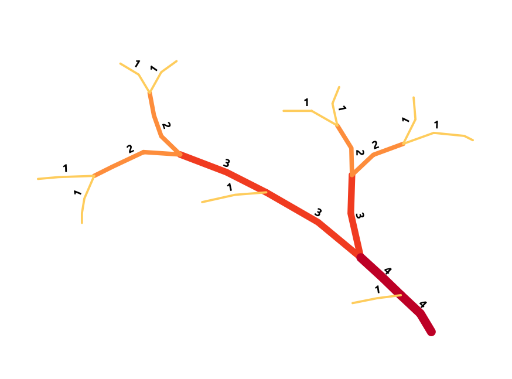

# Strahler para QGIS

Plugin para calcular e registrar a **ordem de Strahler** de cada segmento de uma rede linear diretamente em uma camada vetorial do QGIS.

O projeto atualiza o plugin originalmente desenvolvido por **Alexandre Delahaye**, preservando a finalidade, o algoritmo e a interface original, com adaptações para Python 3, PyQt5 e versões atuais do QGIS.

> **Compatibilidade validada:** QGIS 3.44.15 (Solothurn). Os cálculos foram conferidos durante testes com a rede hidrográfica do **Rio Preto de Pontaleão, na bacia do Rio Madeira**.

## Visão geral

A ordem de Strahler é um método de classificação hierárquica de redes de drenagem. As cabeceiras recebem ordem 1. Quando dois segmentos de mesma ordem se encontram, o segmento a jusante recebe a ordem seguinte. Quando ordens diferentes se encontram, mantém-se a maior ordem.



## Funcionalidades

- Calcula a ordem de Strahler dos segmentos conectados de uma rede linear.
- Grava o resultado em um campo de atributo da camada.
- Permite definir o nome do campo de saída (por padrão, `strahler`).
- Exibe o progresso do processamento.
- Avisa antes de substituir um campo que já existe.

## Requisitos dos dados

Para que o cálculo funcione corretamente, a camada de entrada deve atender a estes requisitos:

- Ser uma camada vetorial de linhas.
- Ter a rede dividida em segmentos individuais nos pontos de junção. Por exemplo, uma junção em T deve ser representada por três segmentos conectados; uma junção em X, por quatro.
- Ter as conexões representadas por extremidades coincidentes.
- Usar geometrias simples de linha (singlepart). Geometrias multipart não são suportadas.

O algoritmo é topológico: não utiliza um Modelo Digital de Elevação (MDE/DEM). Antes de executar, confira a conectividade e a segmentação da rede.

## Como usar

1. Abra o projeto no QGIS e carregue a camada linear que representa a rede.
2. Selecione **um único segmento raiz**: uma das extremidades deve estar conectada à rede e a outra deve estar livre.
3. Abra o plugin **Strahler** pelo menu de vetores ou pelo ícone na barra de ferramentas.
4. Informe o nome do campo que receberá os resultados. O padrão é `strahler`.
5. Execute o processamento e aguarde a barra de progresso terminar.
6. Abra a tabela de atributos da camada e confira os valores calculados.

Se o campo informado já existir, o plugin solicitará confirmação antes de substituir os valores existentes.

## Instalação manual

1. Baixe o ZIP do repositório usando **Code → Download ZIP**.
2. Extraia o arquivo ZIP.
3. Renomeie a pasta extraída para `Strahler`.
4. Copie a pasta `Strahler` para o diretório de plugins do perfil ativo do QGIS. O arquivo `__init__.py` deve ficar diretamente dentro dessa pasta, e não em uma subpasta adicional.
5. Reinicie o QGIS.
6. Abra **Complementos → Gerenciar e Instalar Complementos → Instalados** e habilite **Strahler**.

No Windows, o diretório do perfil padrão costuma ser:

```text
%APPDATA%\QGIS\QGIS3\profiles\default\python\plugins\Strahler
```

Se o QGIS estiver usando outro perfil, utilize a pasta de plugins desse perfil.

## Validação e automação

O funcionamento do algoritmo foi validado no QGIS 3.44.15 por meio da conferência dos cálculos da ordem de Strahler na área de estudo informada acima.

O repositório também utiliza GitHub Actions para executar uma verificação automática de sintaxe dos principais módulos Python. Essa verificação detecta erros de sintaxe, mas não substitui os testes de execução dentro do QGIS.

## Limitações conhecidas

- Geometrias multipart não são suportadas.
- A rede deve estar corretamente segmentada e conectada pelas extremidades.
- É necessário selecionar exatamente um segmento raiz válido.
- O algoritmo não utiliza elevação ou declividade; a classificação considera a topologia da rede.

## Tecnologias

- Python 3
- PyQt5
- API do QGIS
- GitHub Actions

## Créditos e licença

O plugin original foi desenvolvido por **Alexandre Delahaye** em 2016. Esta adaptação mantém os créditos do autor original e segue os termos da **GNU General Public License, versão 2 ou, a critério do usuário, qualquer versão posterior (GPL-2.0-or-later)**.

- Projeto original: [ArMoraer/QGISStrahler](https://github.com/ArMoraer/QGISStrahler)
- Repositório desta adaptação: [LucasDaniel28/Strahler3.0](https://github.com/LucasDaniel28/Strahler3.0)
